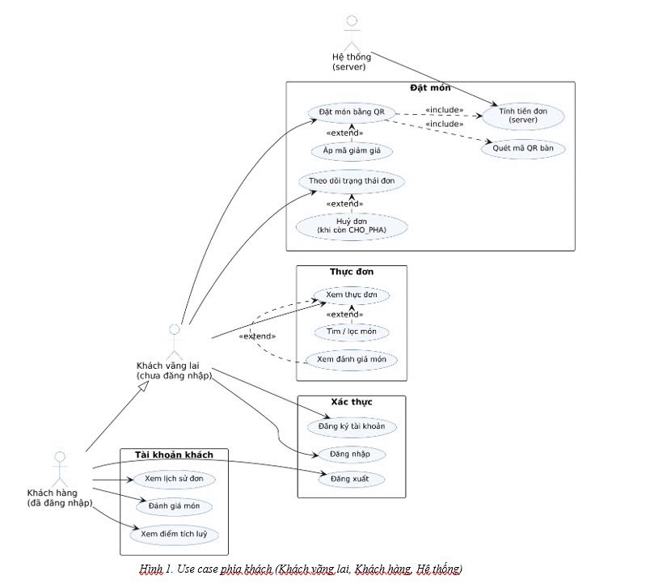
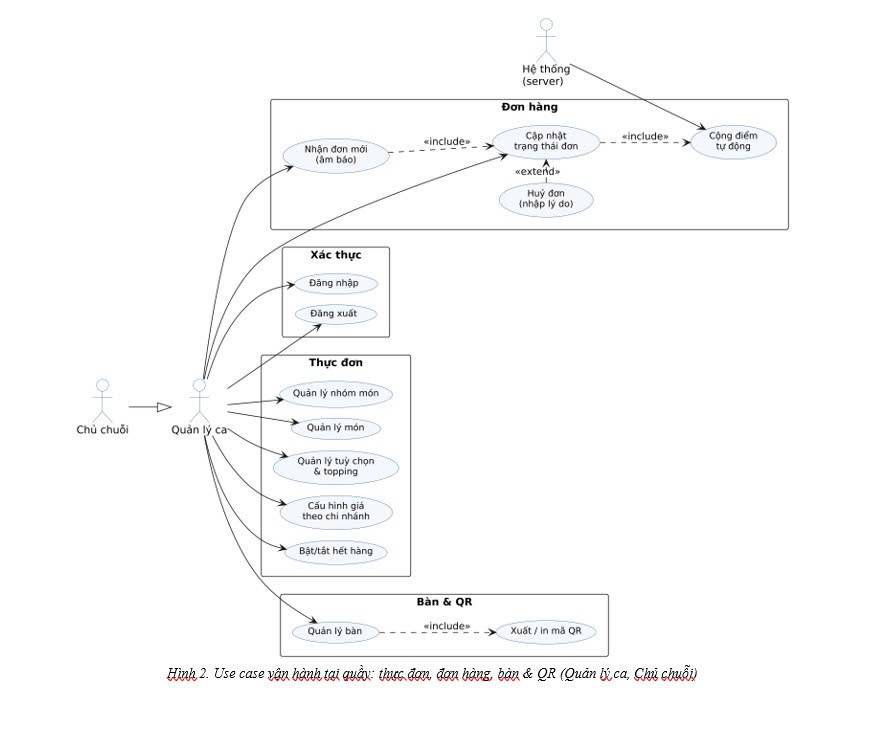
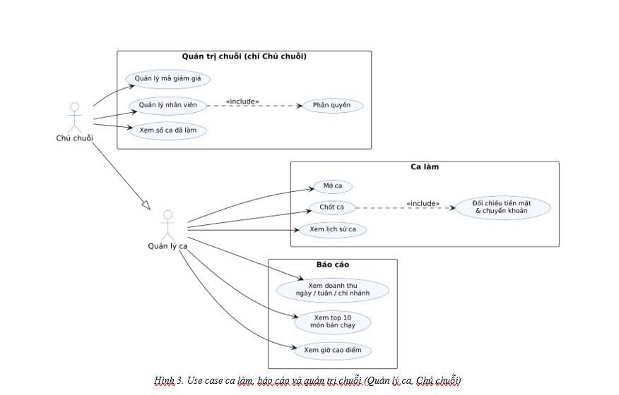
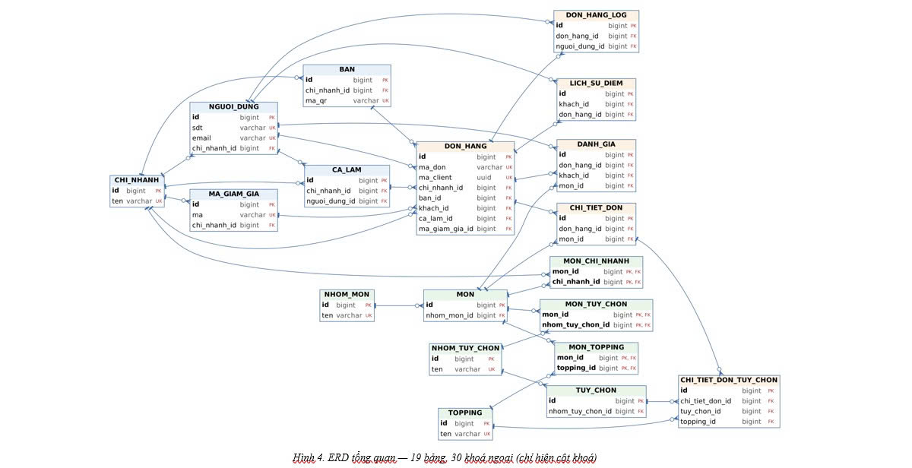

# Hệ thống quản lý chuỗi quán cà phê – trà sữa

**INT4211 – Lập trình trên các thiết bị di động · HK261 · Đề 1 · Nhóm 36**

Một hệ thống gồm hai ứng dụng dùng chung một máy chủ và một cơ sở dữ liệu:
app quản trị cho chủ chuỗi / quản lý ca (Android) và app gọi món bằng QR cho khách (Flutter).
Mọi quyết định nghiệp vụ (giá, phụ thu, giảm giá, quyền hạn) nằm ở backend; app chỉ gửi lựa chọn và hiển thị kết quả.

## Thành viên

| Vai trò | Họ tên | MSSV || Phụ trách chính |
| --- | --- | --- | --- | --- |
| P1 | Huỳnh Anh Tuấn | 231A290052 |  | Backend core + CSDL |
| P2 | Nguyễn Tuấn Thành | 211A290018 |  | App Admin (Android) |
| P3 | Phạm Quang Huy | 231A290095 | | App Client (Flutter) |
| P4 | Huỳnh Dương Gia Huy | 231A010310 | | Backend nghiệp vụ, báo cáo, QA/Deploy |

Chi tiết phân công: [docs/phan-cong.md](docs/phan-cong.md)

## Kiến trúc và công nghệ

| Thành phần | Công nghệ |
| --- | --- |
| App Admin | Android (Java + XML), Retrofit 2 |
| App Client | Flutter 3.35+ (Dart 3) |
| Backend | Node.js 20 + Express 4, JWT + bcrypt, thư viện `pg` (SQL thuần), deploy trên Render |
| Cơ sở dữ liệu | PostgreSQL 15 trên Supabase (19 bảng, 30 khoá ngoại) |

## Cấu trúc repository

```
├── backend/          # REST API (Node.js + Express)
├── admin-android/    # App Admin (Android, Java + XML)
├── client-flutter/   # App Client (Flutter)
└── docs/             # Tài liệu phân tích, thiết kế
```

## Tiến độ theo mốc

| Tuần | Mốc | Trạng thái |
| --- | --- | --- |
| 8 | Đăng ký đề và nhóm | Đã xong |
| 9 | Chốt phân tích (use case, ERD, phân công – bản nháp) | **Đã nộp** – xem bên dưới |
| 11 | Kiểm tra giữa kỳ: backend deploy, ≥ 3 API thật, 2 màn hình mỗi app | Chưa làm |
| 13 | Bản chạy được | Chưa làm |
| 15 | Bảo vệ | Chưa làm |

## Tài liệu mốc tuần 9

- Báo cáo chốt phân tích: [docs/week9/final.docx](docs/week9/final.docx)
- Bảng phân công (bản nháp): [docs/phan-cong.md](docs/phan-cong.md)

### Sơ đồ use case





### Sơ đồ cơ sở dữ liệu (ERD)



